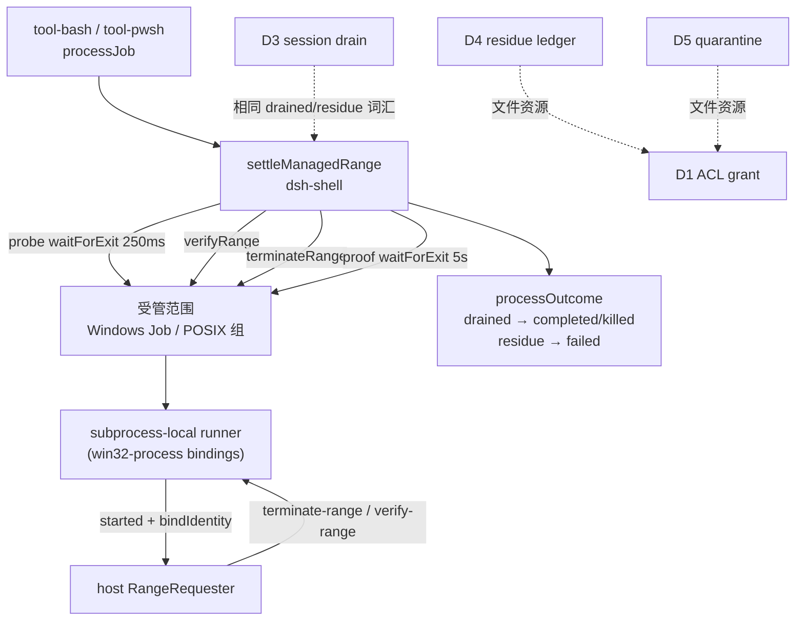

# D1–D7：统一的进程生命周期

> English: [d1-d7-overview.md](d1-d7-overview.md)

七个子系统共同回答一个问题：**一个受管进程范围（Windows Job、POSIX 进程组）
在什么情况下才算真正释放干净**。前六个 D 各自解决一侧的资源治理，D7 把
Shell / Tool / Runner 三层接到同一套语义上。

## 职责分工

| 阶段 | 归属包 | 负责 | 不负责 |
| --- | --- | --- | --- |
| **D1** | `dsh-sandbox-windows-acl` | `AclWriteGrant` 幂等释放、失败时保留 SID 以便重试 | 进程生命周期 |
| **D2** | `dsh-sandbox-local`（lease） | 引用计数的资源租约；最后一个持有者释放资源 | 进程生命周期 |
| **D3** | `dsh-sandbox-local`（lease/session） | Session drain：`open → draining → drained / residue` | Windows Job |
| **D4** | `dsh-sandbox-windows-acl`（ledger） | `ResidueLedger`：记录"未确认释放"的资源，可重试 | 进程残留下落 |
| **D5** | `dsh-sandbox-local`（quarantine） | `QuarantineStore`：持久化隔离记录、原子写入、重试状态 | Job 残留 |
| **D6** | `dsh-shell` | `ShellProcess.waitForExit` 契约：`true`=范围空，`false`=本次等待被取消，`reject`=不可观察；只观察不终止 | 终止策略 |
| **D7** | `dsh-win32-process` / `dsh-subprocess-local` / `dsh-shell` / `dsh-tool-*` | Windows Job 所有权、`terminateRange` / `verifyRange`、`settleManagedRange`、作业结算 | 文件 ACL、沙箱策略本身 |

## 关系图

## 核心不变量

1. **Root `done` ≠ range empty。** `ShellProcess.done` 只结算直连进程；后代仍可能
   活在 Job 里。唯一的"范围已空"证据是 `waitForExit() === true`。
2. **不可证 ≠ 已清空。** `unknown` / `partial` / ACK 超时 / runner 断连都不得映射为
   `empty`（见 [shell-managed-range-contract.zh.md](shell-managed-range-contract.zh.md)）。
3. **观察与终止分离。** `verifyRange` 只观察；`terminateRange` 才终止；
   `waitForExit` 只等待。
4. **residue → failed。** 作业只有范围被证明清空后才允许 `completed`；否则
   `processOutcome` 返回 `failed` 并带证据。

## 与 D1–D5 的边界

D1–D5 管的是**文件系统资源**（ACL、临时目录、SID、隔离记录），D7 管的是
**内核进程对象**（Job、进程组）。两者共享 `drained / residue` 词汇与
"未确认不得报成功"的原则，但**没有**共享记录结构：Job 是匿名内核对象，
runner 一退出句柄即关闭，无法用持久化记录"重新打开"，因此 D4 的
`ResidueKind` 不含进程类型。
