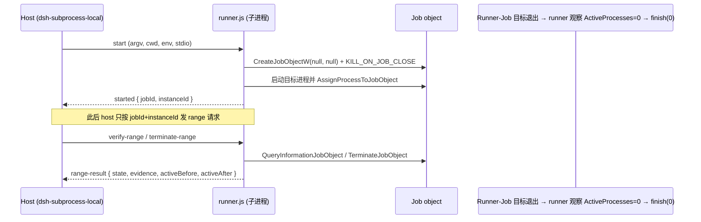

# Windows Job / runner lifecycle

English | [中文](windows-job-runner-lifecycle.zh.md)

Windows 上没有 POSIX 进程组。DSH 用 **Job object** 作为"受管范围"：Job 里的任何成员都随 Job 一起被约束，`JOB_OBJECT_LIMIT_KILL_ON_JOB_CLOSE` 保证最后一个句柄关闭时成员被终止。

## 谁拥有什么

- **Job 是匿名的**：`CreateJobObjectW(null, null)`。`jobId` 只是协议标识，不是内核名字；没有任何方式凭 `jobId` 重新打开一个已销毁的 Job。
- **唯一句柄属于 runner**。runner 进程结束时内核关闭句柄 → `KILL_ON_JOB_CLOSE`触发 → 残留成员被终止。这一点已由产品级 E2E 验证：杀掉 runner 后，原本存活的后代进程消失（`childGone = true`）。
- **host 只能请求，不能直接操作 Job**。所有 range 操作都是 IPC：`terminate-range`、 `verify-range`，应答里带 `state` 与 `evidence`。

## 身份绑定（fail-closed）

Range 请求只在 `started` 握手完成、且 `jobId` 与 `instanceId` 都绑定后才允许发出。未绑定 → `state: 'unknown'`、`evidence: ['identity-unbound']`，**不发 IPC**。runner断连 → 所有在途请求解析为 `unknown` + `runner-disconnected`。

## 状态映射

| 情况 | 应答 |
| --- | --- |
| 终止后发现范围为空 | `terminated` |
| 终止前已为空 | `empty` |
| 终止后仍有成员 | `partial` |
| TerminateJobObject 返回 0 / 抛异常 | `unknown` + `terminate-failed:…` |
| runner 退出/断连 | `unknown` + `runner-disconnected` |
| ACK 超时 | `unknown` + `ack-timeout:…` |

`unknown` 与 `partial` 都不是"已清空"，上层不得据此报告成功。

## 一次正常作业的完整路径

1. `tool-pwsh` 的 `processJob` 调 `ctx.shell.execute`。
2. `pwsh-local` 通过 `ctx.subprocess` 拿到 `LocalSubprocessHandle`。
3. runner 建 Job、跑命令，直连进程退出后 `handle.done` 结算。
4. `processJob` 调用 `settleManagedRange`：probe → verify → terminate → proof。
5. `processOutcome` 把 `drained` 映射为 `completed`/`killed`，`residue` 映射为`failed`。

关键点：第 3 步的 `done` 与第 4 步的范围清空是**两个独立事实**。
